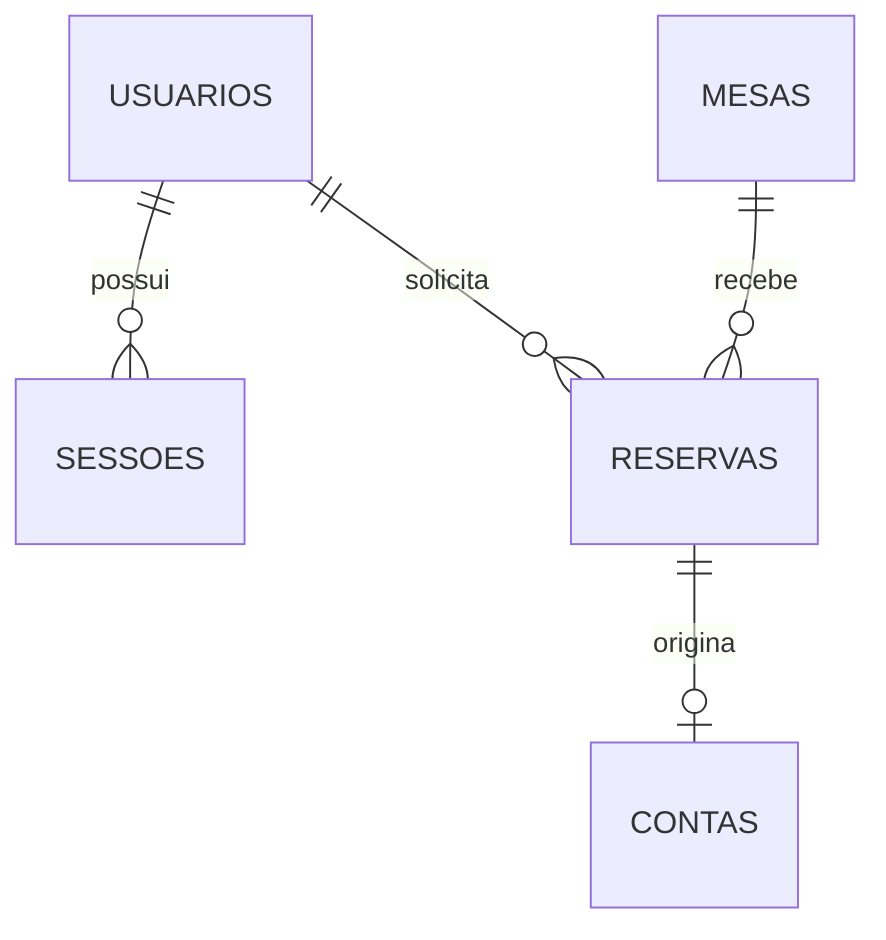
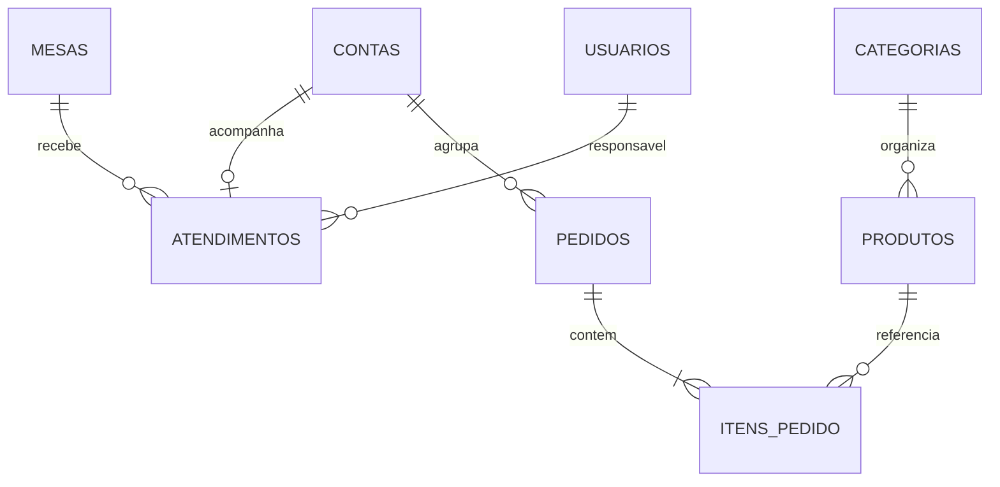
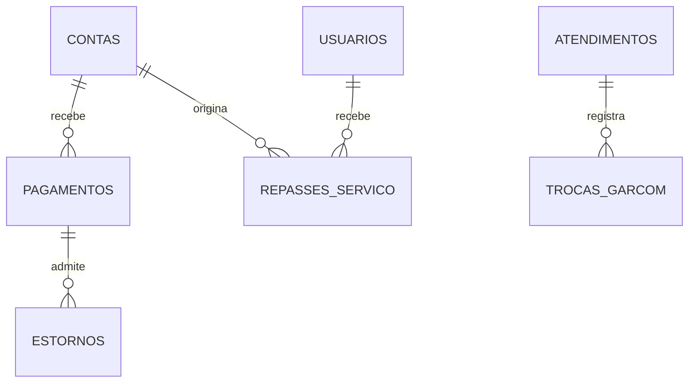
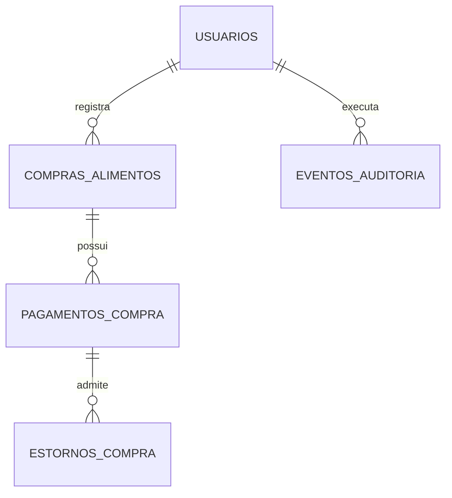

# MesaFlow — Modelagem do banco de dados

Modelo lógico inicial para implementação em PostgreSQL com Sequelize e migrations.

Referência funcional: [Requisitos e regras de negócio](requisitos.md). Este documento descreve a estrutura proposta; não representa um banco já criado ou testado. Detalhes de tipos, índices e restrições deverão ser materializados e verificados nas migrations.

## 1. Decisão central: a conta existe antes do atendimento

Uma conta reúne pedidos, pagamentos e o fechamento financeiro. Ela pode ser criada para uma reserva confirmada, antes da chegada do cliente, ou junto com um atendimento sem reserva.

A conta de uma reserva é única. Quando o atendimento começa, utiliza a mesma conta. Pedidos e pagamentos mantêm seus vínculos originais, sem duplicação de registros. Assim, um pagamento antecipado é abatido uma única vez.

Exemplo: reserva confirmada → conta aberta → pedido de R$ 100 → pagamento antecipado de R$ 40 → atendimento na mesma conta → taxa de R$ 10 → saldo de R$ 70 → pagamento do saldo → fechamento.

`contas` é um conceito interno do sistema, distinto da conta de acesso do usuário.

## 2. Convenções

- Tabelas e colunas em português, com `snake_case`.
- Identificadores UUID como chaves primárias; não substituem autorização.
- Datas de eventos e intervalos em `TIMESTAMPTZ`.
- Fuso operacional inicial: `America/Sao_Paulo`.
- Horários semanais em `TIME`, interpretados no fuso configurado.
- Valores monetários em `NUMERIC(12,2)`, sem conversão indiscriminada para `Number` para cálculo. Os cálculos utilizam aritmética decimal exata ou centavos com validação dos limites.
- Taxa de 10% arredondada uma única vez sobre o total elegível, para dois decimais; no caso de meio centavo, arredondar para cima para valores positivos.
- Quantidades de itens e pessoas em `INTEGER`, maiores que zero.
- `criado_em` e `atualizado_em` nas tabelas mutáveis. Eventos e movimentos históricos são imutáveis, com data do evento.
- Estados representados por valores controlados e restrições `CHECK`; as transições também são verificadas no service.
- Exclusões de registros referenciados são bloqueadas. Inativação e cancelamento preservam o histórico.
- `?` nas listas de campos significa opcional; os outros campos são obrigatórios, salvo condição descrita.
- IDs de autores e responsáveis são FKs para `usuarios`.

## 3. DER por módulo

Os diagramas se complementam. Alguns campos e relações de autoria foram omitidos do desenho para legibilidade e estão descritos no dicionário.

### 3.1 Acesso e reservas

### 3.2 Operação

### 3.3 Recebimentos e gorjetas

### 3.4 Compras e histórico

## 4. Dicionário de tabelas

### 4.1 usuarios

Campos: `id`, `nome`, `email`, `senha_hash`, `telefone?`, `papel`, `ativo`, timestamps.

- `papel`: `admin`, `funcionario` ou `cliente`.
- E-mail normalizado e único, com proteção de unicidade sem distinção de maiúsculas.
- Cadastro público sempre atribui `cliente`.
- Garçons são representados por usuários funcionários aptos ao atendimento, sem tabela de identidade separada.
- Reservas em nome de clientes continuam vinculadas a um cliente cadastrado. O funcionário é registrado como autor; não cria senhas conhecidas para terceiros.

### 4.2 sessoes

Campos: `id`, `usuario_id`, `expira_em`, `revogada_em?`, `criado_em`.

- JWT identifica usuário e sessão.
- Middleware confere sessão ativa e usuário ativo, além da assinatura e expiração do JWT.
- Logout revoga a sessão; token vencido ou sessão revogada não acessa rotas protegidas.
- O JWT completo não é armazenado. Transporte, duração e eventual renovação serão definidos no módulo de autenticação.

### 4.3 configuracoes_restaurante

Campos: `id`, `nome`, `fuso_horario`, `duracao_reserva_minutos`, `tolerancia_minutos`, `atualizado_por`, timestamps.

- Uma única configuração para o restaurante desta versão.
- Valores iniciais: fuso `America/Sao_Paulo`, duração 120 minutos, tolerância 15 minutos.
- Duração positiva e tolerância não negativa.
- A tabela é singleton. Essa decisão apresenta uma divergência com a orientação acadêmica de três registros por tabela e exige alinhamento com o professor; a exceção ainda não está aprovada.

### 4.4 horarios_funcionamento

Campos: `id`, `dia_semana`, `abertura`, `fechamento`, `ativo`, timestamps.

- Convenção: domingo = 0, segunda = 1, até sábado = 6.
- Um intervalo por dia nesta versão; unicidade em `dia_semana`.
- Reservas permitidas somente nos dias 0, 5 e 6.
- Configuração inicial: 18h–23h para cada um desses três dias.
- Fechamento posterior à abertura; horários que atravessam a meia-noite ficam fora desta versão.

### 4.5 mesas

Campos: `id`, `identificacao`, `capacidade`, `ativa`, timestamps.

- Identificação única e capacidade positiva.
- A inativação de uma mesa com reservas futuras exige tratamento prévio dos vínculos, preservando as reservas.

### 4.6 reservas

Campos: `id`, `cliente_id`, `mesa_id`, `inicio_em`, `fim_em`, `quantidade_pessoas`, `status`, `observacoes?`, `tolerancia_minutos_snapshot`, `criado_por`, timestamps.

- Estados: `pendente`, `confirmada`, `concluida`, `cancelada`, `nao_compareceu`.
- `fim_em > inicio_em`; quantidade positiva.
- Início, fim e tolerância são preservados mesmo se as configurações mudarem.
- Reserva pendente ou confirmada bloqueia o intervalo `[inicio_em, fim_em)`.
- Restrição de exclusão PostgreSQL por mesa e intervalo para esses estados, usando GiST e `btree_gist` quando necessário. A migration deverá verificar a disponibilidade da extensão e falhar claramente se não puder criar a proteção.
- Capacidade, calendário e transições são validados no service, com bloqueio da mesa nas operações concorrentes pertinentes.
- Uma reserva cancelada com valores recebidos conserva sua conta até resolver a devolução.

### 4.7 contas

Campos: `id`, `reserva_id?`, `cliente_id?`, `status`, `taxa_servico_aplicada`, `motivo_retirada_taxa?`, `taxa_alterada_por?`, `subtotal_fechamento?`, `taxa_fechamento?`, `total_fechamento?`, `garcom_fechamento_id?`, `fechada_em?`, `fechada_por?`, timestamps.

- Estados: `aberta`, `fechada`, `cancelada`.
- `reserva_id` único quando preenchido; reserva pode existir sem conta, mas não com duas contas.
- Conta vinculada à reserva deve ter o mesmo cliente da reserva.
- Atendimento sem cliente identificado pode ter `cliente_id` nulo; isso não concede acesso público à conta.
- Totais abertos são derivados dos itens válidos, da taxa e dos pagamentos/estornos.
- Snapshots do fechamento são gravados juntos, em transação; não são reescritos por uma edição comum.
- Conta só é cancelada após cancelar os pedidos elegíveis e resolver todos os recebimentos que exigem devolução.
- A remoção da taxa exige motivo e autor.

### 4.8 atendimentos

Campos: `id`, `conta_id`, `mesa_id`, `garcom_id`, `status`, `aberto_em`, `encerrado_em?`, `aberto_por`.

- Estados: `aberto`, `encerrado`.
- `conta_id` único: um atendimento por conta nesta versão.
- Índice único parcial em `mesa_id` para atendimento aberto.
- Mesa e cliente devem ser consistentes com a reserva quando existir.
- Garçom ativo e com papel apropriado; papel é validado no service, pois uma FK não verifica o papel.
- Encerramento é coordenado com fechamento da conta e conclusão da reserva.

### 4.9 categorias

Campos: `id`, `nome`, `ativa`, timestamps.

- Nome único após normalização.
- Inativação impede seleção de produtos dessa categoria para novos pedidos, conforme validação do catálogo.

### 4.10 produtos

Campos: `id`, `categoria_id`, `nome`, `descricao?`, `preco`, `disponivel`, `ativo`, timestamps.

- Preço maior que zero.
- `disponivel` indica disponibilidade operacional; `ativo` indica permanência no catálogo.
- Produto referenciado em pedido não é apagado.

### 4.11 pedidos

Campos: `id`, `conta_id`, `origem`, `status`, `observacoes?`, `criado_por`, `preparo_liberado_por?`, `preparo_liberado_em?`, `cancelado_por?`, `cancelado_em?`, `motivo_cancelamento?`, timestamps.

- Origem: `antecipado` ou `local`.
- Estados: `recebido`, `em_preparo`, `pronto`, `entregue`, `cancelado`.
- Antecipado exige conta vinculada a reserva confirmada.
- Local exige atendimento aberto na conta.
- O início do preparo registra a liberação pela equipe. Pagamento não dispara essa mudança.
- A criação do pedido e de seus itens é atômica; pedidos vazios não são persistidos.
- Cancelamento administrativo após preparo registra autor e motivo e coordena reflexos financeiros.

### 4.12 itens_pedido

Campos: `id`, `pedido_id`, `produto_id`, `nome_produto_snapshot`, `preco_unitario`, `quantidade`, `observacoes?`.

- Quantidade e preço positivos.
- Nome e preço são obtidos pelo backend e preservados.
- Subtotal do item = quantidade × preço unitário.
- Nesta versão, cancelamento é do pedido inteiro. Cancelamento parcial por item exigirá evolução explícita do modelo.

### 4.13 pagamentos

Campos: `id`, `conta_id`, `forma`, `valor`, `dinheiro_entregue?`, `recebido_em`, `registrado_por`, `referencia_externa?`, `criado_em`.

- Formas iniciais controladas: `dinheiro`, `pix`, `cartao_debito`, `cartao_credito`.
- Valor positivo; é o valor aplicado à conta, não o dinheiro entregue para troco.
- Quando houver dinheiro entregue, deve ser maior ou igual ao valor aplicado. Troco é derivado da diferença.
- Linha representa recebimento conferido, não intenção de pagamento.
- Pagamento antecipado pertence à mesma conta usada no atendimento; não precisa ser movido ou recriado.
- Todos os pagamentos se aplicam à conta, não a um item isolado. Os pedidos correspondentes são os da conta, sem distribuição financeira por item nesta versão.
- Dados sensíveis de cartão não são armazenados.

### 4.14 estornos

Campos: `id`, `pagamento_id`, `valor`, `motivo`, `devolvido_em`, `registrado_por`, `referencia_externa?`, `criado_em`.

- Um pagamento admite estornos parciais, cuja soma não pode ultrapassar o valor recebido.
- O registro ocorre somente após conferência da devolução externa.
- O registro do estorno bloqueia a conta e o pagamento, valida o limite e insere o movimento na mesma transação.
- Estorno não altera silenciosamente o valor histórico vendido. Relatórios distinguem venda original, devolução financeira e motivo.
- Devolução comercial de conta fechada não a reabre automaticamente. Correção de registro equivocado exige fluxo administrativo auditado e validação de eventual saldo a recuperar.

### 4.15 trocas_garcom

Campos: `id`, `atendimento_id`, `garcom_anterior_id`, `garcom_novo_id`, `motivo`, `alterado_por`, `alterado_em`.

- Evento imutável, criado junto à atualização do responsável em transação.
- Garçom anterior e novo devem ser diferentes.
- Permitido somente antes do fechamento.

### 4.16 repasses_servico

Campos: `id`, `conta_id`, `garcom_id`, `tipo`, `valor`, `motivo?`, `movimentado_em`, `registrado_por`, `repasse_original_id?`.

- Movimentos: `repasse` e `devolucao_repasse`; valores positivos.
- Um repasse é por conta e garçom; somas por garçom produzem o relatório.
- O repasse fica limitado à taxa efetivamente recebida de conta fechada e ao saldo ainda não repassado.
- `garcom_id` deve corresponder ao snapshot do fechamento.
- Devolução de repasse referencia um repasse original e não pode exceder seu saldo.
- Estorno ao cliente após repasse não gera devolução fictícia pelo garçom; a diferença é sinalizada para regularização.
- A alocação da taxa em estornos deverá ser especificada e testada antes da disponibilização do módulo. Um estorno não é classificado automaticamente como devolução de taxa.

### 4.17 compras_alimentos

Campos: `id`, `descricao`, `fornecedor_nome?`, `data_compra`, `valor_total`, `status`, `registrado_por`, `motivo_cancelamento?`, timestamps.

- Estados: `registrada`, `cancelada`.
- Valor positivo. Uma compra pode representar um documento com vários alimentos descritos; controle físico de estoque não faz parte desta tabela.
- Compras pagas não são alteradas sem rastreabilidade. Correções e cancelamentos devem preservar o histórico.

### 4.18 pagamentos_compra

Campos: `id`, `compra_id`, `forma`, `valor`, `pago_em`, `registrado_por`, `criado_em`.

- Valor positivo. Uma compra admite pagamentos parciais.
- Pagamentos líquidos não podem ultrapassar o valor devido.
- A conta a pagar é calculada. Relatórios distinguem a compra do pagamento, evitando duplicação da despesa.

### 4.19 estornos_compra

Campos: `id`, `pagamento_compra_id`, `valor`, `motivo`, `recebido_em`, `registrado_por`, `criado_em`.

- Registra devolução conferida de valor pago ao fornecedor.
- Soma por pagamento limitada ao valor pago, com transação e bloqueio.
- Permite cancelar/corrigir compras sem apagar saídas financeiras anteriores.

### 4.20 eventos_auditoria

Campos: `id`, `ator_id?`, `acao`, `entidade`, `entidade_id`, `dados_evento`, `ocorrido_em`.

- `dados_evento` em JSONB com campos permitidos explicitamente.
- Sem senhas, tokens, credenciais ou cópias desnecessárias de dados pessoais.
- Registros imutáveis; acesso restrito.
- `entidade_id` é referência lógica para diferentes tabelas, não uma FK universal. A auditoria não substitui as FKs dos dados operacionais.

### 4.21 operacoes_idempotentes

Campos: `id`, `usuario_id`, `operacao`, `chave`, `hash_requisicao`, `status_http`, `resposta_minima`, `criado_em`.

- Unicidade composta em usuário, operação e chave.
- Aplicável à criação de pedidos e ao registro de pagamentos, estornos e repasses.
- Mesma chave e mesmo conteúdo retornam o resultado anterior; mesma chave com conteúdo diferente gera conflito.
- Registro da chave e alteração de negócio são confirmados na mesma transação.
- Duas requisições simultâneas com a mesma chave não podem executar a operação duas vezes.
- Segredos e dados pessoais desnecessários são excluídos do conteúdo persistido.

## 5. Concorrência e transações obrigatórias

| Operação | Proteção planejada |
| --- | --- |
| Criar/editar reserva | Bloqueio da mesa, validação, restrição de exclusão por intervalo |
| Abrir atendimento | Bloqueio da mesa e índice único de atendimento aberto |
| Criar conta de reserva | Unicidade de reserva na conta e transação |
| Criar pedido | Conta bloqueada; pedido e itens na mesma transação; idempotência |
| Registrar pagamento | Conta bloqueada; calcular saldo novamente; idempotência |
| Registrar estorno | Conta e pagamento bloqueados; conferir limites; idempotência |
| Alterar taxa/cancelar pedido | Conta bloqueada; recalcular saldo e tratar eventual devolução |
| Trocar garçom | Atualização e evento na mesma transação |
| Fechar atendimento | Validar estados, saldo e snapshots; fechar conta, atendimento e reserva juntos |
| Pagar compra | Compra bloqueada; conferir saldo e registrar movimento |
| Repassar taxa | Conta bloqueada; conferir taxa recebida e saldo de repasses |

As operações adotam uma ordem consistente de bloqueios e tratamento de conflitos. Transação sozinha não elimina condições de corrida; testes concorrentes reais devem rodar em PostgreSQL.

## 6. Valores e fechamento

- Subtotal = soma dos itens dos pedidos não cancelados.
- Taxa = 10% do subtotal elegível, se aplicada, com arredondamento definido.
- Total = subtotal + taxa.
- Recebido líquido = pagamentos − estornos.
- Saldo = total − recebido líquido.

Saldo positivo indica valor a receber. Saldo negativo indica valor a devolver, não um fechamento quitado. Antes do fechamento, pedidos devem estar entregues ou cancelados, saldo igual a zero e garçom responsável válido.

Snapshot de fechamento registra a venda naquele momento. Estornos posteriores permanecem em movimentos separados para não reescrever o histórico.

## 7. Índices e consistência entre registros

Além de PKs, FKs e índices únicos citados:

- Índices nas FKs usadas em consultas e exclusões controladas.
- Índices de reservas por cliente/data e status/data.
- Pedidos por conta e status/data para cozinha.
- Pagamentos por conta/data e compras por data.
- Auditoria por entidade/identificador/data.
- Correspondência entre a mesa do atendimento e a reserva da conta.
- Consistência entre o cliente da conta e o cliente da reserva.
- Alterações de capacidade da mesa devem considerar reservas futuras existentes.

Regras entre várias tabelas serão reforçadas por transações e, quando adequado, constraints ou triggers nas migrations. Um `CHECK` simples não expressa validações que dependem de consultas a outras tabelas.

## 8. Dados de demonstração e testes

- Dados exclusivamente fictícios.
- Pelo menos três registros válidos por tabela de negócio, conforme o guia, incluindo históricos coerentes quando existirem movimentos.
- A tabela singleton de configuração possui uma linha por definição. A divergência com a quantidade acadêmica mínima permanece pendente de alinhamento com o professor.
- Sessões e idempotência podem ser demonstradas por cenários automatizados com pelo menos três operações, sem publicar tokens válidos.
- Seeds de demonstração não são executados automaticamente em produção.
- Validação das constraints diretamente no banco e por requisições à API.
- Cenários com duas requisições concorrentes e reenvios com a mesma chave.

## 9. Etapas de implementação

1. Configurar backend, PostgreSQL, Sequelize e ferramenta de migrations.
2. Criar usuários e sessões; implementar autenticação e autorização.
3. Criar configurações, horários e mesas.
4. Criar reservas e proteção de disponibilidade.
5. Criar contas e atendimentos.
6. Criar categorias, produtos, pedidos e itens.
7. Criar pagamentos, estornos e fechamento financeiro.
8. Criar histórico de garçons e repasses.
9. Criar compras, pagamentos e devoluções de compras.
10. Integrar telas, relatórios, documentação e testes completos.

Auditoria e idempotência entram junto às primeiras operações que delas dependem, não apenas ao final.

A evolução do esquema é realizada por migrations versionadas. `sync({ force: true })` e `sync({ alter: true })` não fazem parte do fluxo de manutenção do banco.

## 10. Ambiente de desenvolvimento e manutenção do modelo

### 10.1 Ambiente padrão

O ambiente de desenvolvimento previsto para o MesaFlow utiliza Node.js para executar o backend e o frontend, e PostgreSQL em um contêiner Docker gerenciado por Docker Compose. Essa organização permite reproduzir a infraestrutura do banco sem instalar o servidor PostgreSQL diretamente no sistema operacional.

Os pré-requisitos para colaboradores são:

- Git, para obter e versionar o código-fonte.
- Node.js e npm, nas versões que serão indicadas no README e nos arquivos de configuração do projeto.
- Docker Engine com Docker Compose, ou Docker Desktop com suporte a Compose, instalado e em execução.
- Um editor de código e um navegador web.

O uso de Docker Desktop não é obrigatório quando Docker Engine e Compose já estiverem disponíveis. O ambiente deve ser utilizável em Windows, Linux ou macOS, respeitados os requisitos dessas ferramentas.

### 10.2 Banco de dados e persistência

O PostgreSQL será disponibilizado pelo arquivo Compose versionado no repositório. Esse arquivo definirá a versão da imagem, o serviço de banco, o mapeamento de porta, a verificação de disponibilidade e o volume nomeado destinado à persistência dos dados.

A instalação nativa de PostgreSQL ou do cliente `psql` não será necessária no fluxo padrão. O cliente poderá ser executado dentro do contêiner. Ferramentas gráficas de administração serão opcionais.

O volume preservará os dados entre reinicializações e recriações do contêiner, desde que não seja removido. A persistência em volume não substitui backups. Procedimentos de limpeza que removam volumes deverão indicar explicitamente a perda dos dados locais.

### 10.3 Configuração e execução

Cada colaborador utilizará arquivos locais de variáveis de ambiente, criados a partir dos respectivos `.env.example`. Os exemplos documentarão as variáveis necessárias com valores fictícios; credenciais reais não serão versionadas.

O fluxo de preparação previsto é:

1. Clonar o repositório.
2. Configurar as variáveis de ambiente a partir dos exemplos.
3. Iniciar o serviço PostgreSQL com Docker Compose.
4. Instalar as dependências do backend e do frontend.
5. Executar as migrations e, opcionalmente, os dados de demonstração.
6. Iniciar a API e a interface web.
7. Executar as verificações e os testes documentados.

O backend utilizará Sequelize para acesso aos dados e migrations para evolução do esquema. O ambiente local será validado antes da definição da hospedagem em nuvem.

**Estado atual:** esta seção especifica o ambiente planejado. O arquivo Compose, as versões das ferramentas, as portas, as variáveis e os comandos exatos serão disponibilizados no README após implementação e validação. Este documento não pressupõe que esses arquivos e comandos já estejam presentes no repositório.

### 10.4 Manutenção da modelagem

Este documento registra o modelo lógico inicial. As migrations, os models e os testes deverão manter correspondência com o DER e o dicionário de tabelas. Alterações estruturais exigirão atualização conjunta da documentação.

Pontos a detalhar na implementação:

- Tipos físicos, índices e restrições nas migrations.
- Transporte, duração e renovação de sessões.
- Alocação da taxa de serviço em estornos e regularização de repasses.
- Validação acadêmica da tabela singleton em relação ao mínimo de registros de demonstração.
